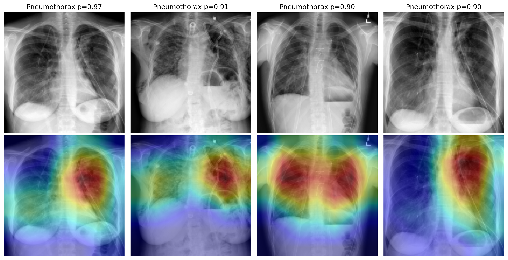
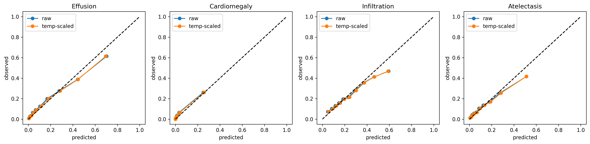

# Explainable Chest X-ray Classification Using Deep Learning

### Multi-Label Classification | Medical Imaging | Explainable AI

An end-to-end deep learning project for predicting **14 thoracic findings** from chest X-ray images using DenseNet121, with additional experiments in metadata fusion, model calibration, subgroup performance analysis, and explainable AI.

**Dataset:** NIH ChestX-ray14  
**Frameworks:** PyTorch, Scikit-learn, Torchvision, Gradio

> **Disclaimer:** This project is intended for research and educational purposes only. It is not a medical diagnostic tool or clinically validated system.

## Project Overview

This project investigates whether deep learning models can identify multiple thoracic findings from chest X-rays and whether patient metadata improves predictive performance.

The project includes:

- Patient-disjoint training, validation, and testing.
- Transfer learning using ImageNet-pretrained DenseNet121.
- Multi-label prediction across 14 thoracic findings.
- Comparison with Gradient Boosting, Logistic Regression, and metadata-only baselines.
- Grad-CAM visual explanations.
- Temperature scaling for probability calibration.
- Performance analysis across patient age, sex, and X-ray view.
- An interactive Gradio demonstration.

## Dataset

The project uses the publicly available NIH ChestX-ray14 dataset.

**Dataset source:** https://www.kaggle.com/datasets/nih-chest-xrays/data

The dataset includes chest radiographs with image-level labels for 14 findings.

The official test partition was preserved, while the official training/validation portion was divided using patient-level grouping to reduce patient leakage.

The raw dataset is not included in this repository. Users must obtain it separately and follow the dataset's applicable terms.

## Model Architecture

The primary model is an ImageNet-pretrained DenseNet121 with its classifier replaced by a 14-output linear layer.

Images were resized to 256 × 256 pixels, cropped to 224 × 224 pixels, normalized, and passed to the network.

The model was fine-tuned using AdamW, a one-cycle learning-rate scheduler, and binary cross-entropy with logits.

## Results

### Model Comparison

| Model | Mean Test AUROC |
|---|---:|
| **DenseNet121** | **0.8148** |
| DenseNet121 + Logistic Regression and metadata | 0.814 |
| DenseNet121 + Gradient Boosting and metadata | 0.803 |
| Metadata only | 0.592 |

The image-only DenseNet121 achieved the highest mean test AUROC. Adding patient age, sex, and X-ray view did not improve overall performance in these exploratory fusion experiments.

### Selected Disease Results

| Finding | Test AUROC |
|---|---:|
| Emphysema | 0.910 |
| Hernia | 0.901 |
| Cardiomegaly | 0.887 |
| Pneumothorax | 0.860 |
| Edema | 0.845 |
| Infiltration | 0.701 |
| Pneumonia | 0.724 |

### Pneumothorax Threshold Evaluation

Using a validation-selected threshold of 0.1667:

| Metric | Test Result |
|---|---:|
| AUROC | 0.8603 |
| Accuracy | 88.32% |
| Precision | 44.67% |
| Sensitivity | 50.99% |
| Specificity | 92.66% |
| F1-score | 0.4763 |

These results demonstrate the importance of choosing decision thresholds carefully, particularly when working with imbalanced medical datasets.

## Explainable AI — Grad-CAM

Grad-CAM was used to visualize image regions contributing to model predictions for cardiomegaly, effusion, and pneumothorax.

Exploratory inspection raised questions about potential reliance on chest tubes and other visual artifacts. These observations are hypotheses and do not establish shortcut learning.

## Probability Calibration

Temperature scaling was applied to model logits.

- **Fitted temperature:** 1.051
- **Mean ECE before calibration:** 0.0157
- **Mean ECE after calibration:** 0.0135

The results indicate a small improvement in average calibration error.

## Subgroup Analysis

Model performance was evaluated across patient sex, age groups, and X-ray view positions.

Descriptive results showed similar mean AUROC for female and male patients, with differences across age groups and AP/PA views.

These subgroup comparisons are exploratory and should not be interpreted as proof of clinical fairness.

## Interactive Gradio Demo

A Gradio prototype allows users to:

- Upload a chest X-ray.
- View independent prediction scores for all 14 findings.
- Select a finding for Grad-CAM.
- View a heatmap overlay showing contributing image regions.

The demo uses the image-only DenseNet121 model and is not intended for clinical use.

## Running the Project

1. Download the NIH ChestX-ray14 dataset from the source linked above.
2. Open `chest_xray_project.ipynb` in Google Colab.
3. Configure dataset paths and Kaggle authentication.
4. Run preprocessing, training, and evaluation cells as needed.
5. For the Gradio prototype, load a compatible trained checkpoint and run the demo section.

Training requires substantial compute and storage. The notebook was developed for a CUDA-enabled Google Colab environment.

## Limitations

- Labels are derived from radiology reports and may contain errors.
- No formal external validation was performed.
- Metadata-fusion experiments reused validation data involved in checkpoint selection.
- Grad-CAM does not provide clinically verified lesion localization.
- Demographic subgroup results are exploratory.
- The model is not suitable for medical diagnosis or clinical decision-making.

## Future Improvements

- Evaluate on an independent chest X-ray dataset.
- Improve stacking evaluation with a dedicated calibration/stacking subset.
- Investigate potential shortcut learning using device annotations.
- Explore clinically relevant threshold selection and more robust calibration.
- Improve reproducibility and deployment.

